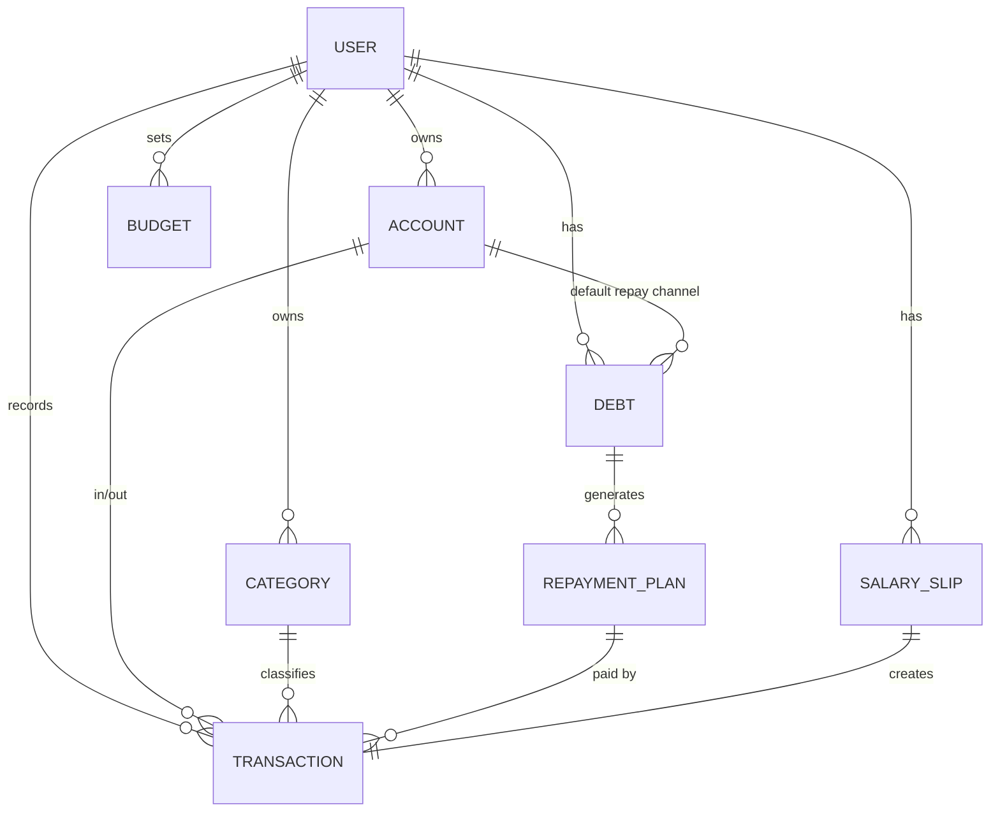

# 个人财务管理系统 · 设计方案（v0.1）

> 目标：一个自己用的网站后台，记录每天的支出、工资和额外收入、各类负债，并自动算出每个月要还多少钱、哪天还、从哪个渠道还。

---

## 1. 要解决的问题

| 场景 | 现在的痛点 | 系统里怎么解决 |
| --- | --- | --- |
| 日常支出 | 钱花在哪不清楚 | 快速记账 + 分类统计 + 月预算 |
| 工资收入 | 只记得到手多少，社保、公积金、个税不清楚 | 工资单录入（应发、扣款、实发） |
| 额外收入 | 兼职、理财、红包、报销等零散收入 | 归入"收入"流水，按来源分类 |
| 负债 | 房贷、信用贷、信用卡、朋友借款分散在各处 | 统一的"负债台账"，记录本金、利率、期数、剩余本金 |
| 每月还款 | 记不住每笔哪天还、还多少、从哪张卡扣 | 自动生成**还款计划**，生成**还款日历**和到期提醒 |
| 还款渠道 | 卡里余额不够导致逾期 | 每笔负债绑定扣款账户，提前预警"某账户本月需备款 X 元" |

---

## 2. 功能模块

```
个人财务管理系统
├── 1. 首页仪表盘        本月收支、待还款、总负债、净资产、图表
├── 2. 记账（流水）      支出 / 收入 / 转账 / 还款，列表筛选，账单导入
├── 3. 收入管理          工资单、额外收入
├── 4. 负债管理          负债台账、新增负债向导、还款计划、提前还款
├── 5. 还款中心          本月应还清单、还款日历、标记已还、逾期提醒
├── 6. 资金账户          银行卡 / 支付宝 / 微信 / 现金 / 信用卡（即"还款渠道"）
├── 7. 统计报表          月度 / 年度报表、分类占比、负债变化趋势
└── 8. 系统设置          分类管理、预算、提醒、数据备份与导出、登录安全
```

### 2.1 首页仪表盘

- **指标卡片**：本月收入、本月支出、本月结余、本月待还款（已还 / 未还）、总负债、净资产（账户余额合计 − 负债合计）
- **健康度指标**：
  - 负债收入比 = 本月应还款 ÷ 本月收入（建议 < 50%，超过显示警告）
  - 储蓄率 = 本月结余 ÷ 本月收入
- **近 7 天到期还款**列表（按日期排序，标出扣款账户、账户余额是否够）
- **图表**：近 12 个月收支趋势（柱状）、本月支出分类（环形）、负债结构（按类型）、剩余负债下降曲线

### 2.2 记账（流水）

- 流水类型：`支出`、`收入`、`转账`（账户之间互转，不算收支）、`还款`（关联某笔负债的某一期）
- 字段：金额、日期时间、账户、分类、备注、标签、附件（小票照片，可选）
- **快速记账**：常用分类一键选，金额 + 分类 + 账户三步完成；支持"再记一笔"
- 列表：按时间、类型、分类、账户、金额区间、关键词筛选；显示筛选结果合计
- **导入**（第二期）：支付宝 / 微信 / 银行 CSV 账单导入，自动按规则映射分类，导入前预览与去重

### 2.3 收入管理

- **工资单**：发薪月份、发薪单位、应发工资、社保、公积金、个税、其他扣款、实发工资、入账账户
  - 保存后自动生成一条"工资收入"流水（金额 = 实发）
  - 可统计全年税前 / 税后收入、个税合计、公积金合计
- **额外收入**：兼职、奖金、理财收益、红包、报销、二手出售等，作为收入分类直接记流水

### 2.4 负债管理（核心）

**负债类型**及默认规则：

| 类型 | 典型还款方式 | 说明 |
| --- | --- | --- |
| 房贷（商贷 / 公积金 / 组合贷） | 等额本息、等额本金 | 组合贷建成两笔负债，分别计算 |
| 车贷 | 等额本息 | |
| 信用贷 / 消费贷（银行、网贷平台） | 等额本息、先息后本 | 记录平台名称 |
| 信用卡 | 按账单还款 / 分期 | 每月录入账单金额；分期按期数生成计划 |
| 朋友 / 亲戚借款 | 自由还款、到期一次还 | 可无利息、可不定期还 |
| 其他 | 自定义 | 手动编辑每期金额 |

**负债字段**：名称、类型、债权人（银行 / 平台 / 朋友姓名）、借款本金、年利率、借款日期、期数、还款方式、每月还款日、默认还款账户（还款渠道）、渠道说明（如"招行储蓄卡自动扣款""微信转给张三"）、剩余本金、状态（还款中 / 已结清）、备注、合同附件。

**新增负债向导**：填写基础信息 → 系统按还款方式**自动生成还款计划**并预览（每期本金、利息、月供、剩余本金）→ 可手动微调某期金额（适配银行实际数字）→ 保存。

**负债详情页**：基本信息、已还期数 / 总期数、已还本金 / 利息、剩余本金、还款计划表、还款记录。

**提前还款**：输入提前还款金额和日期，选择"缩短期限"或"减少月供"，重新生成剩余计划，旧计划保留为历史版本。

**借出（应收）**：负债增加一个方向字段——`借入` / `借出`，借给朋友的钱同样可以记录、跟踪是否已收回。

### 2.5 还款中心

- **本月应还清单**：按还款日排序，每行显示：负债名称、期数、应还金额（本金 + 利息）、还款渠道、状态
- **按渠道汇总**："招行储蓄卡本月需扣 6,800 元，当前余额 5,200 元，缺口 1,600 元" ← 防止逾期最关键的功能
- **还款日历**：月视图，每天显示到期款项
- **标记已还**：选择实际还款日期、金额、账户 → 自动生成一条"还款"流水，扣减账户余额和负债剩余本金；支持部分还款
- **状态**：待还 / 已还 / 部分已还 / 已逾期（过了还款日未还，自动标红）
- **提醒**：到期前 N 天（默认 3 天）站内提醒；第二期支持邮件 / 微信推送

### 2.6 资金账户

- 类型：现金、储蓄卡、信用卡、支付宝、微信、理财账户、其他
- 字段：名称、类型、卡号后四位、初始余额、当前余额（由流水自动计算）、是否计入净资产
- 信用卡作为账户时：额度、账单日、还款日；可自动生成一笔"信用卡负债"每月待还记录
- 账户就是负债的"还款渠道"，一个账户可以绑定多笔负债

### 2.7 统计报表

- 月报：收入、支出、结余、分类明细、与上月对比
- 年报：12 个月趋势、年度总收入 / 支出 / 储蓄、全年利息支出合计
- 负债报表：各负债剩余本金变化、预计全部还清日期、未来 12 个月每月还款压力
- 导出 Excel

### 2.8 系统设置

- 收支分类（两级树形，可自定义图标 / 颜色），预置常用分类
- 月预算：总预算 + 分类预算，超支预警
- 提醒设置：提前天数、提醒方式
- 数据备份：一键导出全部数据（JSON / Excel），定时自动备份数据库
- 登录安全：账号密码 + 可选两步验证，登录日志

---

## 3. 数据模型

金额统一用 `DECIMAL(14,2)`，避免浮点误差；所有表带 `created_at`、`updated_at`、`deleted_at`（软删除）。



### 3.1 表结构

**user 用户**

| 字段 | 类型 | 说明 |
| --- | --- | --- |
| id | bigint PK | |
| username | varchar(50) | 登录名 |
| password_hash | varchar(255) | bcrypt / argon2 |
| totp_secret | varchar(64) | 两步验证（可空） |

**account 资金账户（还款渠道）**

| 字段 | 类型 | 说明 |
| --- | --- | --- |
| id | bigint PK | |
| user_id | bigint FK | |
| name | varchar(50) | 如"招商银行储蓄卡" |
| type | enum | cash / debit_card / credit_card / alipay / wechat / investment / other |
| card_last4 | varchar(4) | 卡号后四位 |
| initial_balance | decimal | 初始余额 |
| balance | decimal | 当前余额（流水变动时更新，可定期校准） |
| credit_limit | decimal | 信用卡额度 |
| bill_day / due_day | tinyint | 信用卡账单日 / 还款日 |
| include_in_net_worth | bool | 是否计入净资产 |
| sort / is_archived | int / bool | |

**category 收支分类**

| 字段 | 类型 | 说明 |
| --- | --- | --- |
| id | bigint PK | |
| user_id | bigint FK | |
| parent_id | bigint | 二级分类 |
| type | enum | expense / income |
| name / icon / color | varchar | |
| is_system | bool | 预置分类（工资、还款利息等）不可删 |

预置分类示例：
- 支出：餐饮、交通、购物、居住（房租 / 水电 / 物业）、通讯、医疗、教育、娱乐、人情往来、**贷款利息**
- 收入：**工资**、奖金、兼职、理财收益、红包、报销、其他

**transaction 流水**

| 字段 | 类型 | 说明 |
| --- | --- | --- |
| id | bigint PK | |
| user_id | bigint FK | |
| type | enum | expense / income / transfer / repayment |
| amount | decimal | 正数 |
| account_id | bigint FK | 出 / 入账账户 |
| to_account_id | bigint FK | 转账目标账户（仅 transfer） |
| category_id | bigint FK | 收支分类 |
| occurred_at | datetime | 发生时间 |
| debt_id | bigint FK | 还款时关联负债 |
| plan_id | bigint FK | 还款时关联第几期 |
| principal_part / interest_part | decimal | 还款流水中本金 / 利息拆分 |
| note / tags | varchar / json | |
| source | enum | manual / import / salary / repayment |
| import_hash | varchar(64) | 导入去重 |

> 说明：还款流水中**本金部分不算支出**（只是负债减少），**利息部分算支出**（计入"贷款利息"分类），这样月度支出统计才准确。

**salary_slip 工资单**

| 字段 | 类型 | 说明 |
| --- | --- | --- |
| id | bigint PK | |
| month | char(7) | 2026-11 |
| employer | varchar(100) | 发薪单位 |
| gross | decimal | 应发 |
| social_insurance / housing_fund / income_tax / other_deduction | decimal | 扣款 |
| net | decimal | 实发 |
| account_id | bigint FK | 入账账户 |
| transaction_id | bigint FK | 自动生成的收入流水 |

**debt 负债**

| 字段 | 类型 | 说明 |
| --- | --- | --- |
| id | bigint PK | |
| user_id | bigint FK | |
| direction | enum | borrow 借入 / lend 借出 |
| name | varchar(100) | 如"XX 小区房贷-商贷部分" |
| type | enum | mortgage / car_loan / credit_loan / credit_card / personal / other |
| creditor | varchar(100) | 债权人：银行 / 平台 / 朋友姓名 |
| principal | decimal | 借款本金 |
| annual_rate | decimal(7,4) | 年利率，如 3.9500（%） |
| rate_type | enum | fixed 固定 / LPR 浮动 |
| start_date | date | 放款日 |
| first_due_date | date | 首次还款日 |
| term_months | int | 期数 |
| repay_method | enum | equal_installment 等额本息 / equal_principal 等额本金 / interest_first 先息后本 / bullet 到期一次还 / flexible 自由还款 |
| repay_day | tinyint | 每月还款日 |
| account_id | bigint FK | 默认还款账户（还款渠道） |
| channel_note | varchar(200) | 渠道说明：自动扣款 / 手动转账 / 微信转给某人 |
| remaining_principal | decimal | 剩余本金 |
| status | enum | active / settled / overdue |
| remark / attachments | text / json | |

**repayment_plan 还款计划（每期一行）**

| 字段 | 类型 | 说明 |
| --- | --- | --- |
| id | bigint PK | |
| debt_id | bigint FK | |
| version | int | 提前还款后重算会生成新版本 |
| period_no | int | 第几期 |
| due_date | date | 应还日期 |
| principal_due / interest_due / total_due | decimal | 应还本金 / 利息 / 合计 |
| remaining_after | decimal | 本期还完后剩余本金 |
| paid_amount | decimal | 已还金额 |
| paid_at | date | 实际还款日 |
| status | enum | pending / paid / partial / overdue |
| account_id | bigint FK | 本期实际扣款账户（默认取负债的账户） |

**budget 预算**

| 字段 | 类型 | 说明 |
| --- | --- | --- |
| month | char(7) | 为空表示每月通用 |
| category_id | bigint | 为空表示总预算 |
| amount | decimal | |

**reminder 提醒**：类型、关联对象、提醒时间、是否已读。
**operation_log 操作日志**：记录金额类数据的增删改，方便追溯。

---

## 4. 核心计算逻辑

设：本金 `P`，月利率 `r = 年利率 / 12`，期数 `n`。

**等额本息**（大多数房贷、车贷、信用贷）

```
每月月供 M = P × r × (1+r)^n / ((1+r)^n − 1)
第 k 期利息 = 上期剩余本金 × r
第 k 期本金 = M − 第 k 期利息
```

**等额本金**

```
每月本金 = P / n
第 k 期利息 = (P − 已还本金) × r
第 k 期月供 = 每月本金 + 第 k 期利息   （逐月递减）
```

**先息后本**：前 n−1 期只还利息 `P × r`，最后一期还 `P + P × r`。
**到期一次还本付息**：一期，金额 `P × (1 + 年利率 × 天数/365)`。
**自由还款（朋友借款）**：不生成计划或只生成一笔"约定还款日"；每次还款记录流水、扣减剩余本金。

**处理细节**
- 计算按"分"四舍五入，**最后一期做尾差调整**，保证本金合计精确等于借款本金
- 银行实际月供常与公式差几分钱 → 计划生成后允许手动修改某期金额
- LPR 浮动利率：支持"从某期起利率调整为 X%"，重新生成后续计划
- 还款日遇到 29/30/31 号而当月没有这一天 → 取当月最后一天
- 每天定时任务：把过了还款日仍未还的计划标为 `overdue`，生成提醒

**关键汇总口径**
- 本月应还款 = 本月 `due_date` 的所有计划 `total_due` 之和 + 信用卡账单
- 按渠道备款 = 本月未还计划按 `account_id` 分组求和，与该账户 `balance` 比较
- 净资产 = Σ 计入净资产的账户余额 + Σ 借出未收回 − Σ 借入剩余本金 − 信用卡未还金额
- 月支出 = 支出流水 + 还款流水中的利息部分（不含本金）

---

## 5. 技术方案

个人使用、数据量小（每年几千条流水），优先**简单、好部署、好备份**。

| 层 | 推荐 | 理由 |
| --- | --- | --- |
| 前端 | Vue 3 + Vite + TypeScript + Element Plus | 后台类组件齐全（表格、表单、日历），中文文档完善 |
| 图表 | ECharts | 饼图、趋势图、日历热力图都有 |
| 后端 | Node.js + NestJS + TypeScript | 前后端同一种语言；模块化结构清晰 |
| ORM | Prisma | 类型安全，迁移方便，支持 SQLite / PostgreSQL 切换 |
| 数据库 | SQLite（起步）→ PostgreSQL（可选） | 单人使用 SQLite 足够，一个文件就能备份 |
| 金额计算 | decimal.js | 避免 JS 浮点误差 |
| 认证 | JWT + bcrypt，可选 TOTP 两步验证 | |
| 定时任务 | @nestjs/schedule | 逾期标记、到期提醒、自动备份 |
| 部署 | Docker Compose（Nginx + 应用 + 数据卷），HTTPS | 云服务器 / 家里 NAS 都能跑 |

> 备选：如果更熟悉 Python，后端可换成 FastAPI + SQLAlchemy，数据模型和接口设计不变。

**项目结构**

```
taskSystem/
├── docs/                  设计文档
├── server/                后端 NestJS
│   ├── prisma/schema.prisma
│   └── src/modules/
│       ├── auth/  account/  category/  transaction/
│       ├── salary/  debt/  repayment/  budget/
│       ├── report/  reminder/  backup/
│       └── common/        金额工具、还款计划计算器
├── web/                   前端 Vue 3
│   └── src/views/
│       ├── dashboard/  transaction/  income/  debt/
│       ├── repayment/  account/  report/  settings/
└── docker-compose.yml
```

---

## 6. 主要接口（REST，前缀 `/api`）

| 模块 | 接口 |
| --- | --- |
| 认证 | `POST /auth/login`、`POST /auth/logout`、`PUT /auth/password` |
| 账户 | `GET/POST /accounts`、`PUT/DELETE /accounts/:id`、`POST /accounts/:id/calibrate`（余额校准） |
| 分类 | `GET/POST /categories`、`PUT/DELETE /categories/:id` |
| 流水 | `GET /transactions?type&from&to&accountId&categoryId&keyword`、`POST /transactions`、`PUT/DELETE /transactions/:id`、`POST /transactions/import` |
| 工资 | `GET/POST /salary-slips`、`PUT/DELETE /salary-slips/:id` |
| 负债 | `GET/POST /debts`、`GET/PUT/DELETE /debts/:id`、`POST /debts/preview-plan`（只计算不保存）、`POST /debts/:id/prepay`（提前还款）、`POST /debts/:id/rate-change` |
| 还款 | `GET /repayments?month=2026-11`、`GET /repayments/calendar?month=`、`GET /repayments/by-channel?month=`、`POST /repayments/:planId/pay` |
| 预算 | `GET/PUT /budgets?month=` |
| 报表 | `GET /reports/dashboard`、`GET /reports/monthly?month=`、`GET /reports/yearly?year=`、`GET /reports/debt-trend` |
| 数据 | `GET /backup/export`、`POST /backup/restore` |

---

## 7. 页面原型（文字版）

**首页**
```
┌──────────┬──────────┬──────────┬──────────┬──────────┐
│ 本月收入  │ 本月支出  │ 本月结余  │ 本月待还  │ 净资产    │
│ 18,500   │ 6,230    │ 12,270   │ 8,485    │ 356,000  │
└──────────┴──────────┴──────────┴──────────┴──────────┘
负债收入比 46%    储蓄率 66%
┌ 近 7 天到期 ──────────────────────────────────────────┐
│ 11-10  房贷-商贷 第 38/360 期  4,745.37  招行储蓄卡 ✔余额足 │
│ 11-12  XX 信用贷 第 5/12 期     1,740.00  支付宝     ⚠缺 300 │
│ 11-15  还朋友张三               2,000.00  微信       待还   │
└──────────────────────────────────────────────────────┘
[ 12 个月收支趋势 ]          [ 本月支出分类 ]
[ 负债结构 ]                 [ 剩余负债下降曲线 ]
```

**负债详情**
```
房贷-商贷部分     中国建设银行   等额本息   年利率 3.95%
本金 1,000,000    剩余本金 942,900.12    已还 37/360 期
还款渠道：招行储蓄卡（自动扣款）   每月 10 号
[提前还款] [利率调整] [编辑]
期数 | 应还日期  | 本金     | 利息     | 月供     | 剩余本金   | 状态
38   | 2026-11-10| 1,641.66 | 3,103.71 | 4,745.37 | 941,258.46 | 待还
...
```

---

## 8. 安全与数据

- 全站 HTTPS；密码 bcrypt 加密；登录失败次数限制；可选两步验证
- 只存卡号后四位，不存完整卡号、密码、身份证号
- 每天自动备份数据库（保留最近 30 份），支持一键导出 Excel / JSON
- 金额类数据修改写操作日志，误删可恢复（软删除）

---

## 9. 开发计划

| 阶段 | 内容 | 预估 |
| --- | --- | --- |
| **第一期 MVP** | 登录、资金账户、分类、记账流水、负债台账（等额本息 / 等额本金 / 自由还款）、还款计划、本月应还 + 标记已还、简单首页 | 1–2 周 |
| **第二期** | 工资单、信用卡账单与分期、先息后本 / 一次性还款、按渠道备款预警、还款日历、预算、统计报表与图表 | 1–2 周 |
| **第三期** | 提前还款与利率调整、支付宝 / 微信账单导入、邮件 / 微信提醒、数据备份恢复、移动端适配（手机记账） | 1–2 周 |

---

## 10. 待确认的问题

1. 只给自己用，还是需要家庭成员（如配偶）共同记账？（影响是否做多用户 / 权限）
2. 部署在哪里：云服务器、家里 NAS，还是只在本机运行？
3. 技术栈偏好：Node.js（NestJS）还是 Python（FastAPI）？
4. 是否需要手机端记账？（响应式网页 / 微信小程序 / PWA）
5. 是否需要导入支付宝、微信账单？
6. 到期提醒希望用什么方式：网页内、邮件、微信（Server 酱 / 企业微信机器人）？
7. 有没有外币或理财 / 股票资产需要记录？
